<div align="center">


<a href="https://github.com/LuisGustavoDev">
  
</a>

<br><br>

[](https://buscatextual.cnpq.br/buscatextual/visualizacv.do?id=K1282810J5)
[](https://www.linkedin.com/in/lu%C3%ADs-gustavo-ribeiro-dos-santos)
[](mailto:luisgustavo7310@gmail.com)

</div>

## Sobre

Sou estudante de Ciência da Computação na UniMAX e desenvolvedor full stack. Gosto de construir APIs, sistemas web e apps do banco de dados até a tela, e de entender como as coisas funcionam por dentro — inclusive o caminho até produção: testes, CI/CD, servidor e CDN.

Fora do código do dia a dia, tenho interesse na área acadêmica e em Machine Learning.

```ts
const luis = {
  papel: "Full Stack Developer",
  estudando: ["Ciência da Computação (UniMAX)", "Machine Learning"],
  construindo: ["APIs", "sistemas web", "apps mobile", "integrações de pagamento"],
  gostaDe: ["lógica de programação", "banco de dados", "boas práticas", "automatizar deploy"],
  perguntemeSobre: ["NestJS", "Next.js", "React Native", "Prisma", "GitHub Actions", "Cloudflare"],
};
```

---

## O que já entreguei

- **Pagamentos** — pacote próprio em TypeScript para Pix, publicado no GitHub Packages, com failover automático entre gateways (InfoPago, Woovi, Pagar.me, Iugu), doação recorrente por Pix Automático e proteção anti-robô.
- **Rastreamento e analytics** — Meta Pixel e Conversions API, GA4, Google Tag Manager, conversões do Google Ads, Microsoft Clarity, Web Vitals de campo (LCP e INP) e testes A/B.
- **Plataforma de vídeo própria** — NestJS + Prisma no back e Next.js no painel: streaming HLS, upload direto para CDN, workspaces com papéis e permissões, testes A/B, métricas por UTM e Docker.
- **APIs** — NestJS com Swagger, validação com Zod, MongoDB e Prisma, chat em tempo real com WebSockets e segredos fora do código.
- **Migrações** — 6 sites levados de WordPress para Next.js com export estático, cuidando de SEO, acessibilidade e Core Web Vitals.
- **CI/CD e infraestrutura** — GitHub Actions com testes, lint e deploy automático por SSH restrito; Nginx, PM2 e Docker em VPS; Cloudflare com cache de HTML, limpeza automática no deploy e Tiered Cache, levando o tempo de resposta do HTML de ~265 ms para ~20 ms.
- **Fluxo de trabalho** — GitHub Flow, Conventional Commits, pull requests e testes com Jest e Vitest.

---
## Stack
<br>
<div align="center">


<p><b>CI/CD, Testes & Infra</b></p>

<p>
  
  
  
  
  
  
  
  
  
  
</p>

</div>


## GitHub

<table align="center">
  <tr>
    <td align="center" width="50%">
      
    </td>
    <td align="center" width="50%">
      
    </td>
  </tr>
</table>


